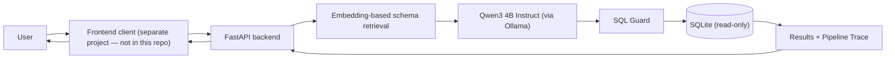
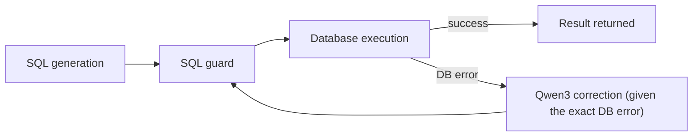

# SQLGenie

**An AI-powered Text-to-SQL analytics agent — ask questions about your data in plain English, get validated SQL and real results back, running entirely on local inference.**

> **Scope note:** this repository contains the **backend** (Python/FastAPI) only. There is no frontend application in this repo (no `package.json`, no React/TypeScript code) — the backend is CORS-configured and trace/theme-aware for a separate frontend client, but that client lives outside this repository. All architecture, setup and tech-stack details below describe what is actually implemented here.

## Related Repository

The frontend for SQLGenie is maintained in a separate repository: [SQLGenie-Frontend](https://github.com/23-nishtha/SQLGenie-Frontend).

---

## 1. Overview

SQLGenie lets a user ask a natural-language question about a structured dataset and get back real query results — no SQL knowledge required. Under the hood:

1. The question is matched against the active database's schema using **embedding-based retrieval-augmented generation (RAG)** — only the relevant tables/columns are selected, not the whole schema.
2. That relevant schema context is handed to a **local Qwen3 4B Instruct model running through Ollama**, which generates one SQL query.
3. The generated SQL passes through a **guardrail layer** (read-only, single-statement, keyword-tokenized validation) before anything touches a database.
4. The validated query executes against a **read-only SQLite connection**.
5. If execution fails (e.g. a wrong column name), the exact database error is sent back to the model for **one or two self-correction attempts** before giving up.
6. The result (rows, SQL, dataset info, and a full step-by-step execution trace) is returned as JSON.

---

## 2. Key Features

- Natural-language Text-to-SQL over SQLite databases
- **Embedding-based RAG** over database schema/metadata (not raw rows)
- Table/question embeddings via **nomic-embed-text**, served locally by Ollama
- **Cosine-similarity** schema ranking, with one-hop foreign-key expansion
- SQL generation via **Qwen3 4B Instruct**, served locally by **Ollama** (no cloud LLM required)
- Optional OpenAI and a network-free mock mode, selectable via one environment variable
- **Three built-in datasets** (Olist e-commerce, international football results, IMDb Top 1000 movies)
- **CSV upload**: any `.csv` becomes a queryable SQLite table and the active dataset immediately
- **SQL guardrails**: single-statement, read-only (SELECT/CTE-only), token-level keyword denylist, automatic row-limit enforcement
- **Read-only database execution** (OS-level `mode=ro` + `PRAGMA query_only`, independent of the guardrail layer)
- **Error-driven SQL self-correction**: a failed query's exact database error is fed back to the model for up to two corrected retries
- **Full pipeline trace** on every request: schema retrieval, SQL generation, guard decision, execution, and any correction attempts, each with timing
- Result data returned as structured **tables** (rows + columns); no charting is implemented
- Backend-provided **theme metadata** per dataset (e.g. `commerce`, `football`, `entertainment`) for a frontend to theme around — the backend never sends styling itself

---

## 3. Architecture



**Self-correction path** (triggered only when validated SQL fails at execution time):



Every corrected query — not just the first attempt — passes through the same SQL guard before execution. A guard rejection (as opposed to a database error) is never retried.

---

## 4. RAG: how retrieval actually works

RAG here applies to **database schema and metadata**, never to raw database rows. SQLGenie does not retrieve or embed table contents, and it does not use a vector database (no Pinecone, Chroma, FAISS, or Weaviate) — embeddings are computed via a local Ollama call and held in an in-memory cache.

The pipeline:

1. **Schema documents** are built for every table/view: its name, real column list (read live from SQLite), and — where a dataset has one — a curated description and keyword set.
2. Each schema document's text (name + columns + description/keywords + any directly-involved relationships) is **embedded once**, using **nomic-embed-text** via Ollama.
3. The **user's question is embedded** the same way, once per request.
4. Schema documents are ranked by **cosine similarity** against the question's embedding.
5. The top-ranked tables are expanded by **one hop** of known foreign-key relationships, so the model always sees how to join what it's given (e.g. asking about orders also pulls in `customers` if they're joined).
6. If nothing ranks confidently, retrieval falls back to a sensible default (the dataset's hub table, or the first table for a single-table dataset).
7. Only this **relevant subset** — plus a few dataset-specific notes — is rendered as text and passed to Qwen3 for SQL generation.
8. **Caching**: table embeddings are computed once per dataset (at startup, or after switching/uploading a dataset) and cached in memory, keyed by dataset — never recomputed per question. Only the question itself is embedded on every request.

A dataset with only one table (every CSV upload, plus the built-in football and movies datasets) skips embedding entirely — there's nothing to rank — and the single table is used directly.

---

## 5. LLM

- **SQL generation model:** Qwen3 4B Instruct, run **locally through Ollama** (`http://localhost:11434` by default) — no request ever leaves the machine for SQL generation in this mode.
- **Why local inference:** no external API credits are consumed, and both the question text and any schema/data context stay on the local machine.
- **Embeddings model:** nomic-embed-text, also served locally through Ollama, used only for schema retrieval (never for SQL generation).
- **Other modes that genuinely exist in the code** (`backend/llm.py`), selectable via `SQLGENIE_LLM_MODE`:
  - `mock` — a deterministic, hand-written lookup table of canned SQL for a fixed set of known questions. No network call, no API key. This is the default, so the project runs out of the box.
  - `openai` — a real call to the OpenAI Chat Completions API (`OPENAI_API_KEY` / `OPENAI_MODEL` required). Schema retrieval still always uses the local Ollama embedding model regardless of this setting — only SQL generation would use OpenAI.

---

## 6. Datasets

**Built-in:**

| Dataset | Domain | Description |
|---|---|---|
| Olist Brazilian E-Commerce | E-commerce | Customers, orders, order items, payments, reviews, products and sellers — the largest built-in schema (10 tables/views). |
| International Football Results | Sports | Match results from 1872–present: teams, scores, competition, venue, and derived winner/goal-difference columns. |
| IMDb Top 1000 Movies | Entertainment | Title, year, rating, genre, director, cast, votes and box-office gross. |

**CSV upload:**

- Accepts **`.csv` files only**.
- The uploaded CSV is converted into a **new SQLite table** (column names and the table name are sanitized into safe SQL identifiers; cell values are inserted via parameterized queries, never string-formatted into SQL).
- The uploaded dataset becomes the **active dataset immediately** after upload — the next question is asked against it.
- A domain/theme (e.g. "sports", "finance") is guessed from the filename, column names, and a sample of values — no LLM is involved in that guess.

---

## 7. Guardrails and safety

Implemented in `backend/sql_guard.py` and `backend/db.py`, and covered by `tests/test_sql_guard.py`:

- **Single statement only** — a payload like `SELECT ...; DROP TABLE ...` is rejected outright.
- **Read-only shape required** — the statement must start with `SELECT` or `WITH` (a CTE); anything else is rejected.
- **Token-level keyword denylist** — every SQL token (not a naive string search) is checked against a denylist including `INSERT`, `UPDATE`, `DELETE`, `DROP`, `ALTER`, `CREATE`, `TRUNCATE`, `ATTACH`, `PRAGMA`, `VACUUM`, and transaction/permission statements. This also catches a CTE followed by a disallowed statement (e.g. `WITH t AS (SELECT 1) DELETE FROM orders`), since the whole statement is scanned, not just the first keyword.
- The denylist check only matches real SQL **keyword tokens** — the word "delete" appearing inside a quoted string value is correctly left alone.
- **Automatic row limiting** — if the generated SQL has no `LIMIT`, one is added (wrapping the query rather than naively appending text, so it's safe even if the query ends in `ORDER BY` or a comment); the limit is configurable (`MAX_ROWS`, default 200).
- **Read-only execution, independent of the guard** — `backend/db.py` opens the SQLite file with `mode=ro` and sets `PRAGMA query_only`, so even if the guard were somehow bypassed, the database connection itself refuses writes.
- **Query timeout** — a long-running query is aborted via a SQLite progress handler (`QUERY_TIMEOUT_SECONDS`, default 10s), guarding against an accidental runaway query (e.g. an unintended cross join).

This is a guard against **writes and runaway queries**, not a general SQL-injection firewall for arbitrary intent — a read-only query that happens to use a classic injection shape (e.g. `OR '1'='1'`) is still just a read, and is allowed, since it cannot modify or exfiltrate anything beyond what the query already had access to.

---

## 8. Self-correction

When a generated query passes the guard but fails against the real database (e.g. a column name that doesn't exist), SQLGenie doesn't give up immediately:

1. The exact SQLite error is sent back to the model along with the original question, the schema context, and the failed SQL.
2. The model returns a corrected query.
3. The corrected query goes through the **exact same guard and execution path** as the first attempt — correction only changes how new SQL is *proposed*, never how it's *approved*.
4. This repeats for up to **2 correction attempts** (3 total tries, including the first). If every attempt fails, the request returns a clear error listing what was tried and why each attempt failed.

A guard rejection (invalid/unsafe SQL) is never retried — only a genuine database execution error triggers a correction attempt.

---

## 9. Tech Stack

| Layer | Technology |
|---|---|
| Backend framework | Python + FastAPI |
| Database | SQLite |
| SQL generation LLM | Qwen3 4B Instruct |
| Embeddings model | nomic-embed-text |
| Local inference runtime | Ollama |
| SQL parsing/validation | `sqlparse` + custom guardrail logic (`backend/sql_guard.py`) |
| CSV handling | `pandas` |
| API server | `uvicorn` |
| Testing | `pytest` |
| Version control | Git + GitHub |
| Frontend | *Not included in this repository* (a separate client is expected to call this API; CORS is pre-configured for local dev on ports 5173 and 8080) |

---

## 10. Project Structure

```text
SQLGenie/
├── backend/
│   ├── main.py              # FastAPI app: HTTP endpoints, CORS, error mapping
│   ├── agent.py             # Pipeline orchestration + self-correction loop
│   ├── llm.py                # SQL generation (mock/openai/ollama) + embeddings (Ollama)
│   ├── mock_llm.py          # Canned SQL answers for the zero-network "mock" mode
│   ├── schema_retrieval.py  # Embedding-based RAG: ranking, caching, FK expansion
│   ├── schema_context.py    # Reads live table/column info straight from SQLite
│   ├── schema_profiles.py   # Curated per-dataset descriptions/keywords/relationships
│   ├── sql_guard.py         # SQL validation guardrails
│   ├── db.py                 # Read-only SQLite execution
│   ├── dataset.py           # Dataset registry + active dataset (built-in + uploaded)
│   ├── csv_upload.py         # CSV → SQLite conversion and sanitization
│   ├── domain_detection.py   # Guesses an uploaded dataset's domain/theme
│   ├── trace.py              # Step-by-step pipeline trace recording
│   ├── models.py             # Pydantic request/response/trace schemas
│   └── config.py             # Environment-driven settings
├── database/
│   ├── football/football.db, movies/movies.db  # Committed directly (small)
│   ├── olist.db.sha256      # Committed checksum; olist.db itself is NOT committed — see §13
│   └── raw/                   # Raw source CSVs for the Olist dataset (git-ignored)
├── scripts/
│   └── fetch_olist_db.py    # Render build-time step: downloads + SHA-256-verifies olist.db
├── tests/                     # pytest suite
├── uploads/                    # Runtime storage for uploaded CSV-derived SQLite files (git-ignored, EPHEMERAL on Render)
├── requirements.txt
├── render.yaml               # Render Blueprint (optional — see §13.7 for the manual equivalent)
├── .python-version           # Pins Python 3.13 for Render
├── .env.example
└── README.md
```

---

## 11. Setup (Windows)

### 1. Clone and create a Python environment

```powershell
git clone <this-repo-url>
cd SQLGenie
python -m venv .venv
.venv\Scripts\activate
pip install -r requirements.txt
```

### 2. Install and configure Ollama

Download and install Ollama from [ollama.com](https://ollama.com), then pull the SQL-generation and embedding models:

```powershell
ollama pull qwen3:4b
ollama pull nomic-embed-text:latest
```

> The default SQL-generation model is `qwen3:4b` (`OLLAMA_MODEL` in `.env`). If you prefer a specific instruction-tuned quantization (e.g. `qwen3:4b-instruct-2507-q4_K_M`), pull that tag instead and set `OLLAMA_MODEL` accordingly.

Make sure Ollama is running (it typically runs as a background service after install; otherwise start it with `ollama serve`).

### 3. Configure environment variables

```powershell
copy .env.example .env
```

Edit `.env` as needed. Key variables (see `.env.example` for the full, commented list):

| Variable | Purpose |
|---|---|
| `SQLGENIE_LLM_MODE` | `mock` (default, no network), `openai`, or `ollama` |
| `OLLAMA_MODEL` | SQL-generation model tag |
| `OLLAMA_EMBED_MODEL` | Embedding model tag (default `nomic-embed-text:latest`) |
| `OLLAMA_BASE_URL` | Ollama's API URL (default `http://localhost:11434`) |
| `SQLGENIE_DATASET` | Which built-in dataset is active at startup (default `olist`) |
| `CORS_ALLOWED_ORIGINS` | Allowed frontend origins |

To use the real Qwen3 model rather than the network-free mock answers, set:

```dotenv
SQLGENIE_LLM_MODE=ollama
```

Never commit a real `.env` file or any API key — `.env` is git-ignored; only `.env.example` (no secrets) is tracked.

### 4. Start the backend

```powershell
uvicorn backend.main:app --reload
```

The API is now available at `http://127.0.0.1:8000`, with interactive docs at `http://127.0.0.1:8000/docs`.

> There is no frontend to start in this repository — see the scope note at the top.

---

## 12. Testing

```powershell
pytest
```

Latest verified result:

```text
254 passed, 2 warnings
```

The two warnings are FastAPI deprecation warnings (`@app.on_event("startup")` is deprecated in favor of lifespan event handlers) — they don't indicate a test failure. The suite requires no live Ollama server, no OpenAI key, and no real network access: `SQLGENIE_LLM_MODE` is pinned to `mock` for the test session, and embedding calls are intercepted with a deterministic, in-process fake.

No frontend test suite exists in this repository.

---

## 13. Deploying the Backend to Render

This section covers the **backend only** (a Render free web service). The frontend deploys separately to Vercel — see `SQLGenie-Frontend`'s own repo; nothing here touches it.

### 13.1 Files involved

| File | Purpose |
|---|---|
| `render.yaml` | A Blueprint: declares the service, build/start commands, health check, and every environment variable (secrets marked `sync: false` — never stored in the file). Optional — see §13.7 for the manual-dashboard equivalent. |
| `.python-version` | Pins the Python version to `3.13`, matching local development. |
| `scripts/fetch_olist_db.py` | Downloads and SHA-256-verifies `database/olist.db` at build time (see §13.6). |
| `database/olist.db.sha256` | The Olist database's expected checksum, committed to git so the verification itself is reviewable. |
| `.env.example` | Every environment variable this app reads, documented — never real secrets. |

### 13.2 Production startup command

```
uvicorn backend.main:app --host 0.0.0.0 --port ${PORT:-10000} --proxy-headers --forwarded-allow-ips 127.0.0.1
```

Already set as `startCommand` in `render.yaml`. Breaking it down:
- **No `--reload`** — that's a development-only flag (auto-restarts on file changes); it must never run in production.
- **`--host 0.0.0.0`** — Render's proxy connects over the network, not loopback, so binding only to `127.0.0.1` (uvicorn's own default) would make the app unreachable.
- **`--port ${PORT:-10000}`** — Render's documented default web-service port is `10000`; this reads a `PORT` env var if one is set, and falls back to `10000` if not, so it works either way.
- **`--forwarded-allow-ips 127.0.0.1`** — see §13.12. This is not optional; leaving it out creates a real, verified weakness.

### 13.3 Dependencies

`requirements.txt` already includes everything needed: `fastapi`, `uvicorn[standard]`, `google-genai`, `openai`, `python-dotenv`, `sqlparse`, `python-multipart`, `pandas`, `pytest`. No changes were needed here for deployment — only the Gemini SDK was added earlier (Stage 1).

### 13.4 Environment variables (set in Render's dashboard, never committed)

Every variable `backend/config.py` reads is documented in `.env.example`. The ones that matter most for a Render deployment, and must be set through Render's **Environment** tab (or prompted once via Blueprint — see §13.7) rather than hardcoded anywhere:

| Variable | Set to | Why |
|---|---|---|
| `SQLGENIE_LLM_MODE` | `gemini` | Enables Gemini SQL generation/correction/embeddings |
| `GEMINI_API_KEY` | *(your real key)* | **Secret.** Never in git, never in `render.yaml` — paste directly into the dashboard |
| `GEMINI_MODEL` | `gemini-3.6-flash` | Verified against Google's current model list (Stage 1) |
| `GEMINI_EMBED_MODEL` | `gemini-embedding-001` | Same |
| `CORS_ALLOWED_ORIGINS` | your deployed Vercel URL, e.g. `https://your-app.vercel.app` | Never `*` — see `backend/main.py`'s CORS setup |
| `TRUST_PROXY_HEADERS` | `true` | **Required for correct rate limiting on Render** — see §13.12 |
| `ENABLE_DEBUG_ENDPOINTS` | `false` (or just leave unset — it defaults to `false`) | See §13.10 |
| `OLIST_DB_URL` | the Olist `.db` Release asset's download URL | See §13.6 — only needed at build time |
| `DATABASE_PATH`, `UPLOADS_DIR`, `MAX_ROWS`, `QUERY_TIMEOUT_SECONDS`, `MAX_QUESTION_LENGTH`, `RATE_LIMIT_*` | the defaults already shown in `.env.example` | Already sensible defaults; override only if real traffic needs it |

### 13.5 Gemini mode

Fully configured through the four variables above — no code change is needed to switch providers. `SQLGENIE_LLM_MODE=mock`/`openai`/`ollama` still work exactly as before (Stage 1 added Gemini alongside them, never in place of them).

### 13.6 Olist database delivery (GitHub Release asset + SHA-256 verification)

`database/olist.db` is ~183 MB — GitHub hard-blocks any file over 100 MB pushed without Git LFS, which this project deliberately avoids (per your own instruction). Instead:

1. **You create a GitHub Release** on this repo (I haven't, and won't, push or create anything) and upload `database/olist.db` as a Release asset.
2. Copy that asset's direct download URL and set it as `OLIST_DB_URL` in Render's dashboard.
3. Render's build command (`pip install -r requirements.txt && python scripts/fetch_olist_db.py`) downloads it and verifies its SHA-256 against the checksum already committed in `database/olist.db.sha256`:
   ```
   32323719515c830bfc6b5d41cc24cb54ad072853162a168f3ffa2384d6c360a0  olist.db
   ```
   This is the real checksum of your current local `database/olist.db`, computed and verified during this stage (not guessed).
4. **The build fails loudly** — non-zero exit, clear message — if `OLIST_DB_URL` is unset, the download fails, or the checksum doesn't match. This app will never silently start up with a missing or corrupted Olist database.

I tested all four code paths of `scripts/fetch_olist_db.py` directly (missing file + no URL, checksum mismatch, successful download, and "already valid, skip re-download") against an isolated sandbox copy — not your real `database/olist.db`, which I verified is still byte-identical afterward.

Locally, this script is a no-op: your `database/olist.db` already exists and already matches the checksum, so `database/build_db.py`'s normal local workflow is completely unaffected.

### 13.7 Manual dashboard setup (if you skip the Blueprint)

If you'd rather not use `render.yaml`: create a new Web Service pointing at this repo, set **Build Command** and **Start Command** to the two commands in §13.2/13.3's build line, set **Health Check Path** to `/health`, and add every variable from §13.4 under **Environment**.

### 13.8 Football and IMDb (Movies) databases

Both are small enough to commit directly (`football.db` ≈ 9 MB, `movies.db` ≈ 556 KB) — no download step needed, unlike Olist. `.gitignore`'s blanket `*.db` rule now carves out explicit exceptions for exactly these two files:
```
!database/football/football.db
!database/movies/movies.db
```
`database/olist.db` remains gitignored even with this change — only these two specific files are affected. **I have not run `git add`/`git commit` for them** — per your instructions, that's a step for you to run explicitly:
```powershell
git add database/football/football.db database/movies/movies.db
```

### 13.9 Database paths and uploaded-CSV storage on Render's filesystem

- `DATABASE_PATH` (built-in datasets) and `UPLOADS_DIR` (CSV uploads) are both already configurable via environment variables (`backend/config.py`) — no code change was needed.
- **Render's free-tier filesystem is ephemeral.** Anything written at runtime — every CSV upload converted via `POST /datasets/upload` — is lost on every restart and every redeploy. Built-in datasets (Olist/Football/Movies) survive because they're placed there by the *build* step (§13.6, §13.8), not written at runtime.
- This is a genuine limitation, not a bug to fix: a CSV uploaded by one visitor will not survive the service spinning down from inactivity (see §13.11) or a redeploy. Documenting this clearly (here, and in the frontend-facing copy if relevant) is the agreed approach — no S3/R2/persistent-disk integration was added, matching your original scope.

### 13.10 Debug endpoints stay off

`ENABLE_DEBUG_ENDPOINTS` defaults to `false` in every environment (Stage 2.1) — `render.yaml` sets it explicitly to `false` as well, so a Blueprint deploy can't accidentally leave it unset in a way that surprises anyone. `GET /debug/retrieve` 404s (not 403 — it reveals nothing) unless this is deliberately flipped on, which it should never be on a public deployment: it calls the same embedding model `/ask` does, as a real Gemini API call, with no auth.

### 13.11 Free-tier limitations (documented, not engineered around)

- **Sleep / cold start:** Render's free web services spin down after 15 minutes with no inbound traffic, and the next request takes roughly a minute while the instance restarts. The first request a recruiter makes after the demo has been idle will be slow — this is expected, not a bug.
- **Gemini embedding warm-up, on every process start:** in `gemini` mode, FastAPI's startup hook (`schema_retrieval.init_documents()`) re-embeds every table of the active dataset's schema — and it does this on **every** process start, not just the first-ever deploy, because the embedding cache lives only in that process's memory and is never persisted across restarts. Measured directly in this project's own local smoke test, warming up the Olist dataset (10 tables) took approximately **15–20 seconds**. Combined with the sleep/cold-start behavior above, a visitor hitting the demo right after it's been idle can expect roughly **60–90 seconds** before the first response of any kind — Render's own ~1-minute spin-up, extended by this warm-up (which runs inside that same window, since Render's health check can't pass until the startup hook finishes, so the two delays overlap rather than simply stacking). Because nothing is cached across restarts, **every** wake-from-sleep repeats this embedding work and spends real Gemini API quota reproducing output identical to the previous run — on a free tier with intermittent demo traffic, this can add up over a day of sporadic visits even though no visitor asked a single question.
- **Ephemeral runtime storage:** see §13.9 — uploaded CSV datasets never persist across a restart or redeploy.
- **Single instance, single worker — required, not just assumed:** `backend/rate_limit.py`'s limiters hold their state in this one process's memory. Running more than one worker (`uvicorn --workers N>1`) or scaling to more than one Render instance would give each worker/instance its own independent counters, silently multiplying every configured rate limit by the worker/instance count. The startup command in §13.2 does not set `--workers`, and Render's free plan is single-instance by default — this matches that assumption, but it's worth stating as a hard requirement, not an incidental fact: do not add `--workers` to the start command without also replacing the in-memory limiter with a shared store.

### 13.12 Proxy-header configuration and post-deployment IP verification

This is the part of the whole deployment I'd flag as most important to get right, and the one place I want to be explicit about what's **verified from primary sources** versus what still needs confirming against the real deployment.

**What's verified, from Render's own current docs and uvicorn's own source (not community reports):**
- Render automatically sets `FORWARDED_ALLOW_IPS=*` for every Python service (confirmed from `render.com/docs/environment-variables`).
- uvicorn's `--proxy-headers` is **on by default**, and when `forwarded_allow_ips` resolves to `*` (which it would, picking up Render's own env var, if left unset on the command line), uvicorn's `ProxyHeadersMiddleware` trusts the **first** entry of `X-Forwarded-For` — the one a client can set themselves — to rewrite `request.client.host` (confirmed by reading `uvicorn.middleware.proxy_headers`'s installed source directly).
- Combined, those two facts mean: deploying with uvicorn's defaults on Render would make `request.client.host` silently trust an arbitrary, client-spoofable header — exactly the risk this app's own `TRUST_PROXY_HEADERS` setting was built to avoid, just introduced one layer down, by the ASGI server instead of this app's code.
- The fix is the `--forwarded-allow-ips 127.0.0.1` flag already in §13.2's start command — an explicit CLI flag overrides the environment variable (confirmed from uvicorn's `Config` source), restoring the safe loopback-only default regardless of what Render sets.

**What is still NOT verified, and must be checked against the real deployment, not assumed:**
- Whether Render's reverse proxy appends to (rather than replaces) a client-supplied `X-Forwarded-For`, and whether the *last* entry is reliably the one the proxy itself added. The reasoning in `backend/rate_limit.py`'s `get_client_ip()` is based on community-support reports, not Render's primary documentation — I was unable to find an authoritative page confirming this behavior, and I'm not presenting it as verified.

**How to verify it after deploying, without logging or exposing any real IP address:**
1. Set `TRUST_PROXY_HEADERS=true` (already in `render.yaml`).
2. From one real network (e.g. home Wi-Fi), send `/ask` requests until you get a `429`.
3. Immediately, from a genuinely different real network (phone on cellular data, a friend's connection, a VPN exit node), send one `/ask` request.
4. **If `200`:** the resolution correctly distinguishes real visitors — the assumption holds for this deployment. **If `429`:** every visitor is sharing one bucket, meaning either `TRUST_PROXY_HEADERS` isn't taking effect or Render's `X-Forwarded-For` doesn't behave the way `get_client_ip()` assumes — stop and re-investigate before trusting the rate limiter for anything beyond "the whole app has one shared budget."

This test only ever produces HTTP status codes — no IP address is written to a log, displayed, or recorded anywhere to run it.

---

## 14. Example Questions

**Football** (built-in dataset)

- "Which team has the most wins?"
- "How many matches has Brazil played?"
- "What is the highest goal difference in a match?"

**Olist** (built-in e-commerce dataset)

- "How many orders were delivered?"
- "What are the top 5 product categories by revenue?"
- "What is the average order value?"

**IMDb Top 1000 Movies** (built-in dataset)

- "What are the top 5 highest rated movies?"
- "Which director has the most movies?"
- "What is the average rating by genre?"

**CSV upload** (e.g. uploading a `titanic.csv` with passenger/survival columns — illustrative, not a bundled dataset)

- "How many rows are in this dataset?"
- "How many passengers survived?" — works once the uploaded CSV actually has a `survived`-style column; CSV upload itself is fully generic and dataset-agnostic.

---

## 15. Resume-ready project description

- Built an end-to-end Text-to-SQL analytics agent that converts natural-language questions into validated, executed SQL using a locally-hosted Qwen3 4B Instruct model via Ollama — no cloud LLM dependency.
- Designed and implemented an embedding-based RAG pipeline over database schema metadata (nomic-embed-text embeddings, cosine-similarity ranking, one-hop foreign-key expansion, in-memory caching) to keep LLM context small and accurate across multiple heterogeneous datasets.
- Implemented a layered SQL safety system — token-level guardrails, read-only database execution, and error-driven self-correction — with a full step-by-step execution trace returned on every request for observability.

---

## 16. Future Scope

> Future improvements — not currently implemented.

- A bundled frontend client in this repository
- Chart/visualization rendering of query results
- Support for additional local embedding/LLM model options
- Persistent (disk-backed) embedding cache across process restarts
- Automatic cleanup of old uploaded datasets

---

## 17. License

No license file currently exists in this repository. A license can be added later.
